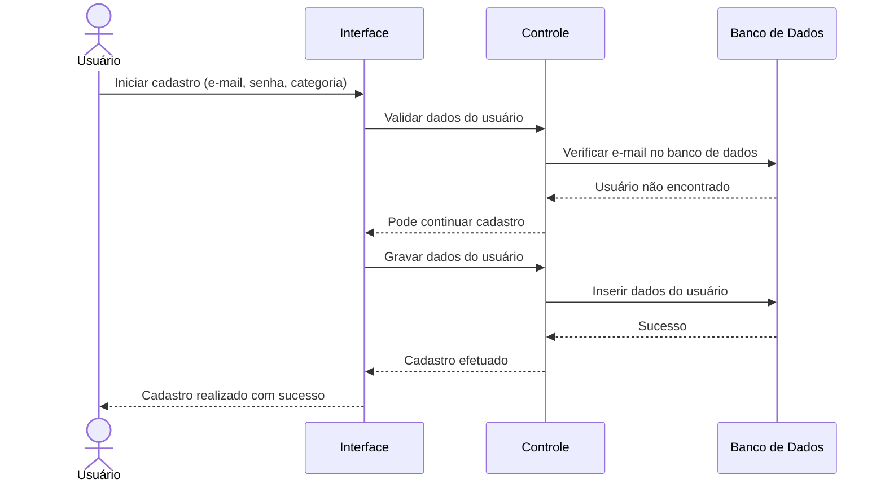
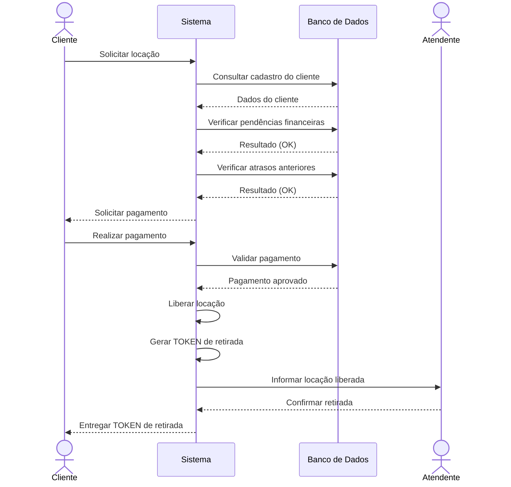
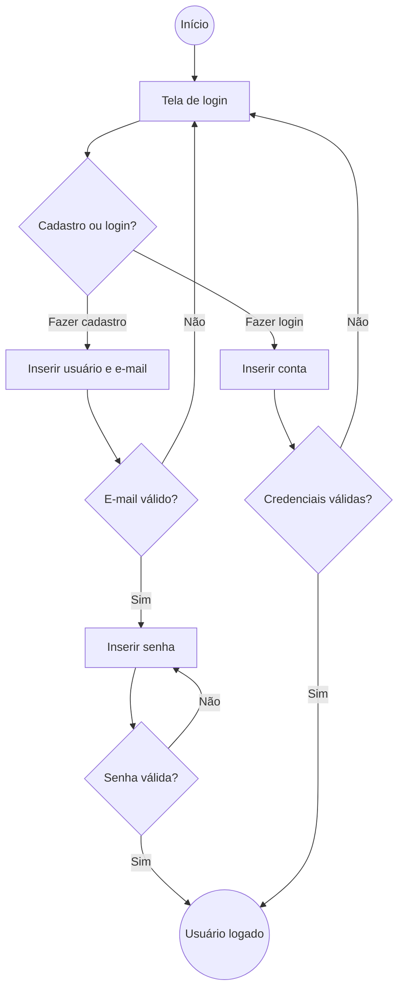

# 🎮 Sistema da Locadora Corujão Games

> Universidade Federal do Amazonas (UFAM) · Instituto de Ciências Exatas e Tecnologia (ICET)
> Curso de Engenharia de Software · Itacoatiara/AM · 2026

## 👥 Equipe

| Integrantes |
|---|
| Guilherme Alencar dos Santos |
| Kairlly de Sousa Magalhães |
| Matheus Raulino Pucu |

**Disciplina:** Engenharia de Requisitos · **Professor:** Walter Viana

---

## 📑 Sumário

1. [Introdução](#1-introdução)
2. [Requisitos Gerais do Software](#2-requisitos-gerais-do-software)
3. [Diagramas UML](#3-diagramas-uml)

---

## 1. Introdução

### 1.1. Descrição Geral do Software

O **Sistema da Locadora Corujão Games** é uma aplicação web para apoiar a gestão de uma locadora de jogos e consoles. O objetivo é substituir controles manuais por um fluxo digital de cadastro de clientes, consulta de catálogo, reserva, locação e devolução, reduzindo erros de estoque, cobranças indevidas e filas de atendimento.

Com o sistema, o **cliente** se cadastra, consulta o catálogo com filtros de busca, reserva jogos e consoles e solicita locações. A reserva gera automaticamente um **TOKEN de retirada**. O **atendente** analisa as solicitações, libera as locações mediante validação de pagamento e do histórico do cliente e registra as devoluções, com cálculo automático de multa em caso de atraso. O **gerente** administra o inventário e o cadastro de jogos, consoles e funcionários.

> **Fora do escopo:** o sistema não contempla venda de produtos. O processamento financeiro limita-se à validação de pagamento e de pendências para a liberação da locação.

**Termos e abreviações**

| Sigla | Significado |
|---|---|
| RF | Requisito Funcional |
| RNF | Requisito Não Funcional |
| RN | Regra de Negócio |
| UC | Caso de Uso |
| UML | Unified Modeling Language |
| TOKEN | Código gerado pelo sistema para autorizar a retirada de um item reservado ou locado |

### 1.2. Descrição dos Usuários

| Perfil | Descrição |
|---|---|
| 👤 **Cliente** | Pessoa que deseja consultar o catálogo, reservar e locar jogos e consoles e acompanhar suas reservas. |
| 🧑‍💼 **Atendente** | Funcionário responsável por cadastrar clientes presencialmente, analisar solicitações de locação, liberar locações, avaliar o histórico do cliente e registrar devoluções e multas. |
| 🛠️ **Gerente** | Funcionário responsável pela gestão do inventário e pelo cadastro de jogos, consoles e funcionários. Herda as permissões do atendente (generalização no diagrama de casos de uso). |

---

## 2. Requisitos Gerais do Software

### 2.1. Requisitos Funcionais

| Código | Descrição | Escopo | Prioridade |
|---|---|---|---|
| **RF01** | O sistema deve permitir que novos clientes realizem seu cadastro informando e-mail, senha e categoria. | Geral | Essencial |
| **RF02** | O sistema deve permitir a consulta ao catálogo de jogos e consoles com filtros de busca. | Geral | Essencial |
| **RF03** | O sistema deve permitir a reserva de jogos/consoles e a geração automática de TOKEN de retirada. | Geral | Essencial |
| **RF04** | O sistema deve permitir a solicitação e a liberação de locações mediante validação financeira e de histórico. | Geral | Essencial |
| **RF05** | O sistema deve registrar a devolução de itens e calcular multas por atraso quando aplicável. | Geral | Importante |
| **RF06** | O sistema deve permitir ao gerente e ao atendente cadastrar jogos, consoles e funcionários e gerenciar o inventário. | Gestão | Essencial |
| **RF07** | O sistema deve permitir que o usuário logado encerre sua sessão (logout). | Geral | Importante |
| **RF08** | O sistema deve permitir que o usuário cadastrado acesse o sistema por meio de login com e-mail e senha. | Geral | Essencial |

### 2.2. Requisitos Não Funcionais

| Código | Descrição | Categoria |
|---|---|---|
| **RNF01** | O sistema deve validar os dados e realizar a autenticação do usuário em até 2 segundos. | Desempenho |
| **RNF02** | O sistema deve manter a segurança e a privacidade das senhas e dos dados dos usuários, além de associar os TOKENs de retirada com segurança aos perfis. | Segurança |
| **RNF03** | O sistema deve estar disponível via web/internet para consulta e reserva de catálogo. | Disponibilidade |

### 2.3. Regras de Negócio

| Código | Descrição | Escopo | Prioridade |
|---|---|---|---|
| **RN01** | Não é permitido cadastrar dois usuários com o mesmo e-mail no sistema. | Geral | Essencial |
| **RN02** | A liberação de locação exige validação de pagamento, verificação de atrasos anteriores e ausência de pendências financeiras. | Locação | Essencial |
| **RN03** | A reserva de jogos/consoles ou a liberação de locação gera obrigatoriamente um TOKEN de retirada. | Reserva/Locação | Essencial |
| **RN04** | A devolução de itens em atraso gera cálculo de multa automática com base no histórico do cliente. | Devolução | Importante |

---

## 3. Diagramas UML

### 3.1. Diagramas de Casos de Uso

**Atores:** Cliente, Atendente e Gerente (o Gerente herda do Atendente).

| Ator | Casos de uso |
|---|---|
| Cliente | Realizar Cadastro, Consultar Catálogo de Jogos, Reservar Jogo, Solicitar Locação, Realizar Pagamento |
| Atendente | Cadastrar Cliente, Analisar Solicitação de Locação, Registrar Devolução |
| Gerente | Cadastrar Funcionário, Cadastrar Jogo/Console, Gerenciar Inventário de Jogos (além dos casos do Atendente) |

**Relações `<<include>>`:**

- Reservar Jogo → Gerar TOKEN de Retirada
- Solicitar Locação → Gerar TOKEN de Retirada
- Liberar Locação → Gerar TOKEN de Retirada
- Liberar Locação → Validar Pagamento → Verificar Atrasos Anteriores → Verificar Pendências Financeiras
- Registrar Devolução → Calcular Multa por Atraso
- Cadastrar Jogo/Console → Atualizar Status do Jogo

#### Especificação dos casos de uso

<b>UC1 – Cadastrar</b>

| Campo | Descrição |
|---|---|
| Ator principal | Cliente |
| Atores secundários | Gerente, Atendente |
| Resumo | Permite que um novo cliente se cadastre para poder utilizar os serviços de locação. |
| Pré-condições | Acessar a tela inicial do sistema ou estar presencialmente na locadora com o atendimento aberto. |
| Pós-condições | Um novo perfil é criado no banco de dados e o cliente fica apto a fazer login e solicitar locações. |
| Fluxo principal | 1. O ator clica em *Realizar cadastro*; 2. O sistema exibe a tela de cadastro; 3. O ator informa e-mail, senha e categoria e confirma; 4. O sistema valida as informações; 5. O sistema confirma a criação do cadastro. |
| Restrições | Se os dados não forem válidos, o cadastro não é efetivado (RN01). |

<b>UC2 – Consultar Catálogo de Jogos</b>

| Campo | Descrição |
|---|---|
| Ator principal | Usuário |
| Resumo | Permite visualizar os jogos e consoles disponíveis, filtrando por categoria, plataforma ou disponibilidade. |
| Pré-condições | Nenhuma (acesso público ou logado). |
| Pós-condições | O catálogo é exibido com informações atualizadas. |
| Fluxo principal | 1. O ator seleciona *Consultar Catálogo*; 2. O sistema busca os itens ativos e disponíveis; 3. O sistema exibe a listagem; 4. O ator aplica filtros; 5. O sistema atualiza os resultados. |
| Restrições | Se nenhum item corresponder aos filtros, o sistema informa que nenhum resultado foi encontrado. |

<b>UC3 – Reservar Jogo (gera TOKEN de retirada)</b>

| Campo | Descrição |
|---|---|
| Ator principal | Cliente |
| Resumo | O cliente reserva um item do catálogo antes de ir buscá-lo; o sistema gera automaticamente um TOKEN de retirada. |
| Pré-condições | O cliente deve estar logado e ter acesso à internet. |
| Pós-condições | O item fica reservado (indisponível para outros) e o TOKEN é salvo no perfil do cliente. |
| Fluxo principal | 1. O cliente escolhe o item e clica em *Reservar*; 2. O sistema verifica a disponibilidade; 3. O sistema gera o TOKEN associado ao cliente (RN03); 4. O sistema altera o status do item para *Reservado*; 5. O sistema exibe a confirmação e o TOKEN. |

### 3.2. Diagramas de Sequência

#### Sequência – Cadastrar

#### Sequência – Solicitar Locação

### 3.3. Diagramas de Atividades

---

## 📌 Observações

Documentação informal elaborada a partir do documento de requisitos no padrão ISO/IEC/IEEE 29148 do mesmo sistema.
